# Lab 10 - Jenkins CI/CD Pipeline Report

**Name:** Karl Khouri
**Repository:** https://github.com/karlkhoury/lab10-karlkhouri
**Jenkins job:** Python-CI-CD (Pipeline script from SCM, branch `main`, Script Path `Jenkinsfile_Karl_Khouri`)

## Part 3 - Base Pipeline

Stages: Setup, Lint, Test, Deploy.

- `app.py` returns `Hello, {name} from Karl Khouri!` so the unit test in `tests/test_app.py` passes.
- `tests/__init__.py` makes `tests` a package so pytest can import `app` from the project root.
- `requirements.txt` includes `pytest` because the Test stage runs it.
- The activate step uses `.` instead of `source` because Jenkins runs `sh` steps with `/bin/sh`, which does not support `source`.

Build #1 result: **SUCCESS** (Setup, Lint, Test, Deploy all passed, 1 test passed).

## Part 4 - Changes Made

1. **Coverage stage:** runs `coverage run -m pytest tests/` and then `coverage report -m` to print a coverage report.
2. **Security Scan stage:** runs `bandit -r . -x ./venv` to scan the project source for vulnerabilities (the virtual environment is excluded so only project code is scanned).
3. **Deploy stage:** runs `deploy.sh`, a local deployment script that copies `app.py` and `requirements.txt` to `$HOME/deployments/python-ci-cd` and runs the application from there.
4. **requirements.txt:** added `coverage` and `bandit`.

Final stage order: Setup, Lint, Test, Coverage, Security Scan, Deploy, followed by `cleanWs()`.

## Part 4 - Jenkins Build Output (Build #2)

Result: **SUCCESS** - all stages passed.

**Test**
```
collected 1 item
tests/test_app.py .                                                      [100%]
============================== 1 passed in 0.02s ===============================
```

**Coverage**
```
Name                Stmts   Miss  Cover   Missing
-------------------------------------------------
app.py                  4      1    75%   6
tests/__init__.py       0      0   100%
tests/test_app.py       7      1    86%   11
-------------------------------------------------
TOTAL                  11      2    82%
```

**Security Scan**
```
Test results:
	No issues identified.
Code scanned:
	Total lines of code: 11
Run metrics:
	Total issues (by severity):
		Undefined: 0
		Low: 0
		Medium: 0
		High: 0
```

**Deploy**
```
Deploying application...
Hello, World from Karl Khouri!
Application deployed to /var/jenkins_home/deployments/python-ci-cd
```

**Post Actions**
```
[WS-CLEANUP] Deleting project workspace...
[WS-CLEANUP] done
Finished: SUCCESS
```

## Screenshots

### Part 1 - Jenkins Setup

Jenkins dashboard with the `Python-CI-CD` job:

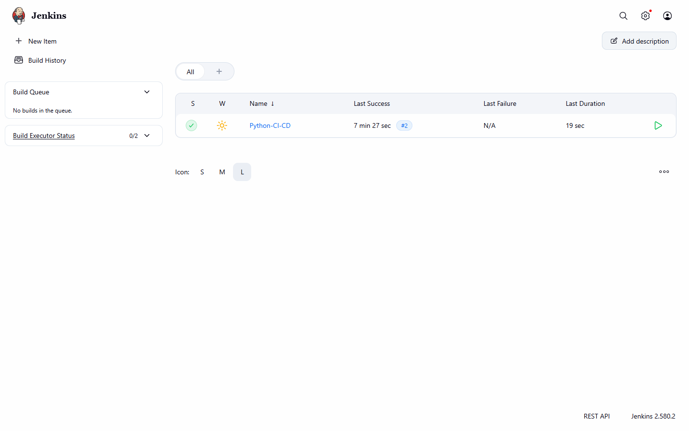

Installed plugins (Git, Pipeline, SSH Agent, Workspace Cleanup, Stage View):

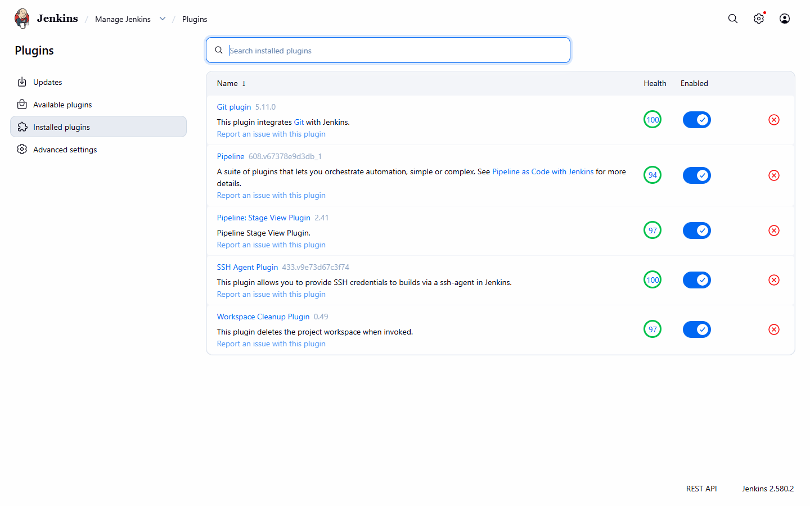

### Part 3 - Job Configuration and Build #1

Pipeline script from SCM, Git repository URL, branch `*/main`, Script Path `Jenkinsfile_Karl_Khouri`:

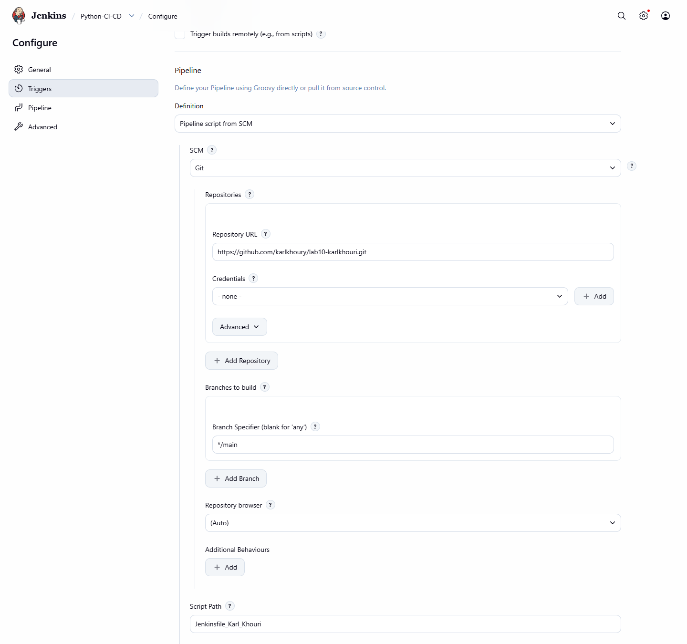

Build #1 console - checkout from GitHub:

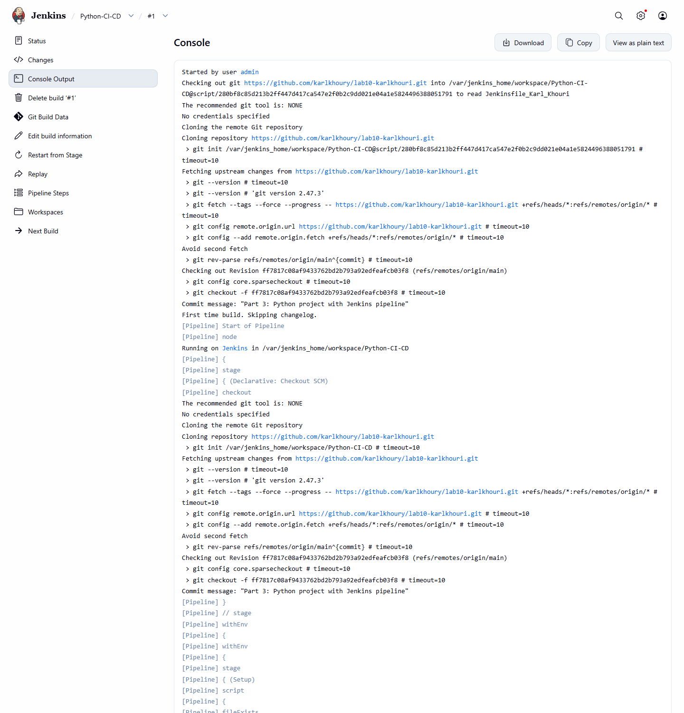

Build #1 console - Test stage:

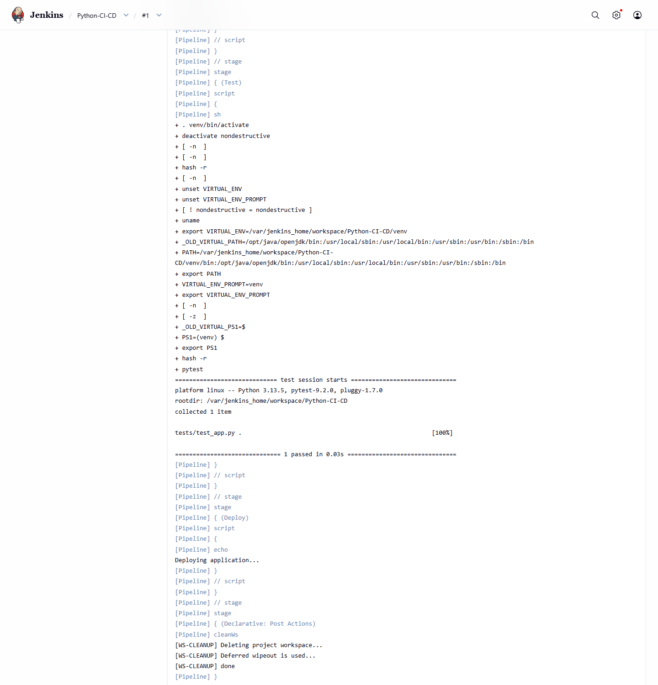

Build #1 console - Deploy stage and `Finished: SUCCESS`:

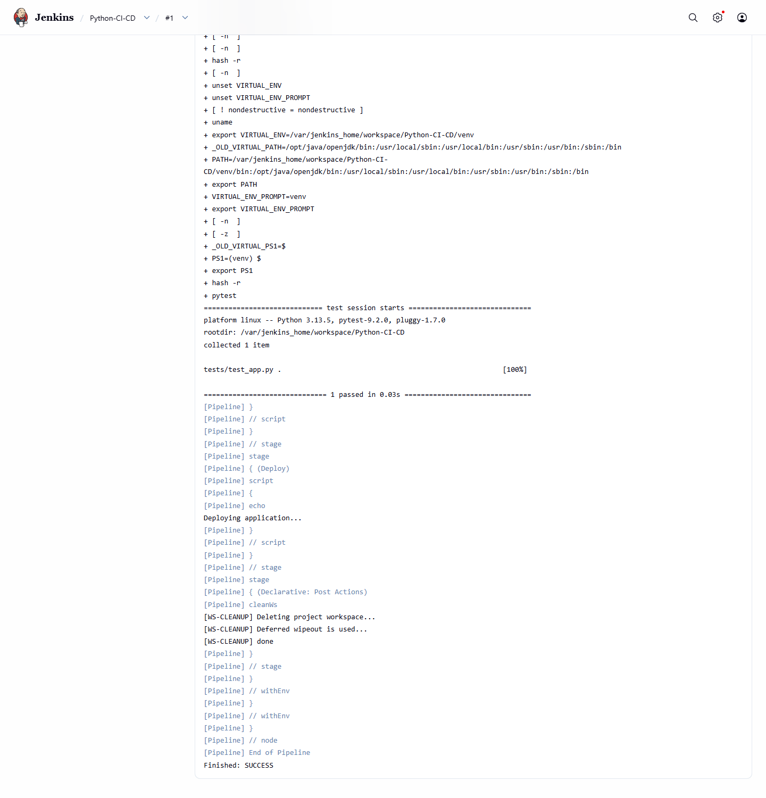

### Part 4 - Build #2

Stage View showing all stages passing (Setup, Lint, Test, Coverage, Security Scan, Deploy):

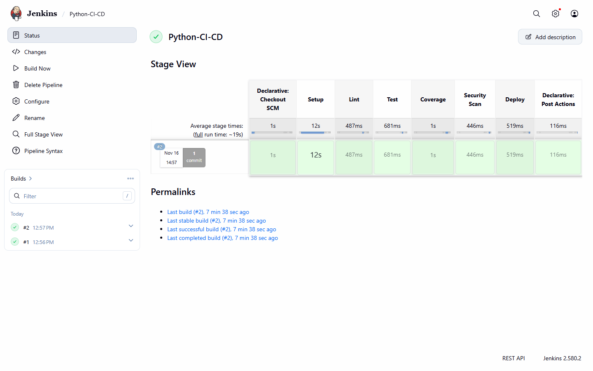

Build #2 console - checkout and Setup:

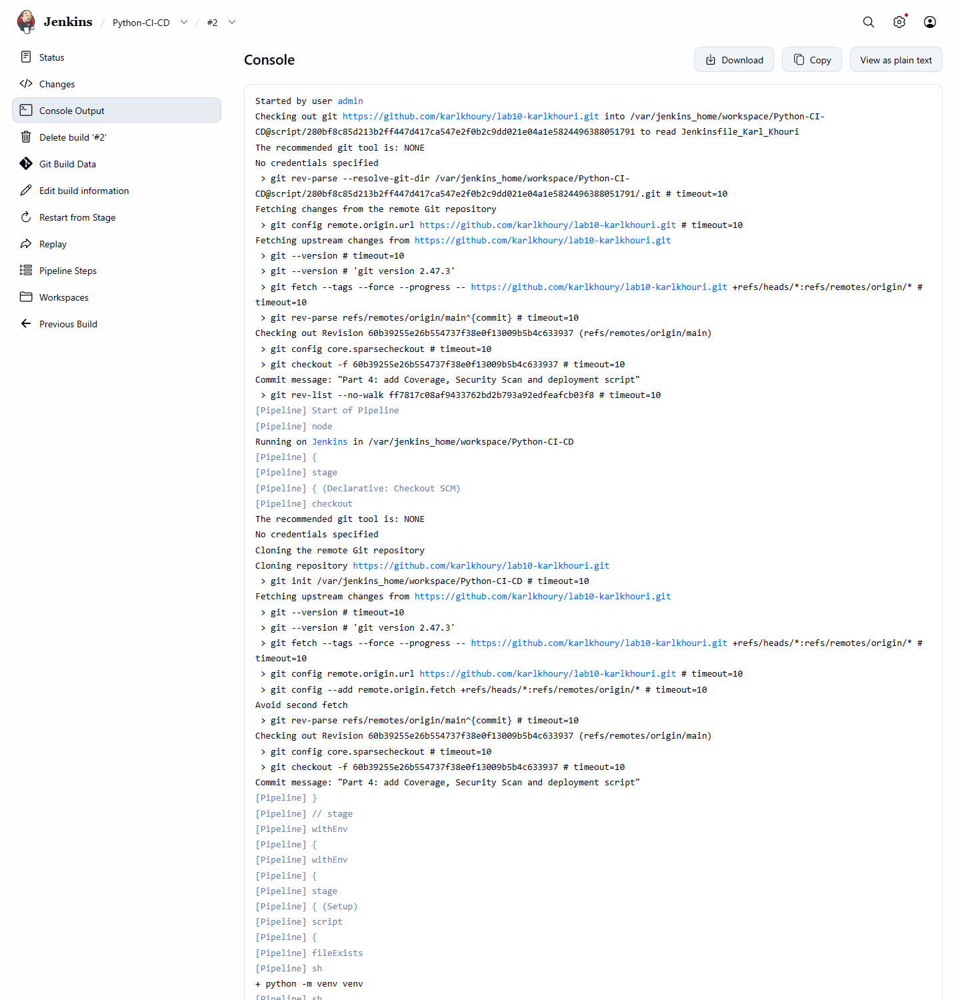

Build #2 console - Test stage:

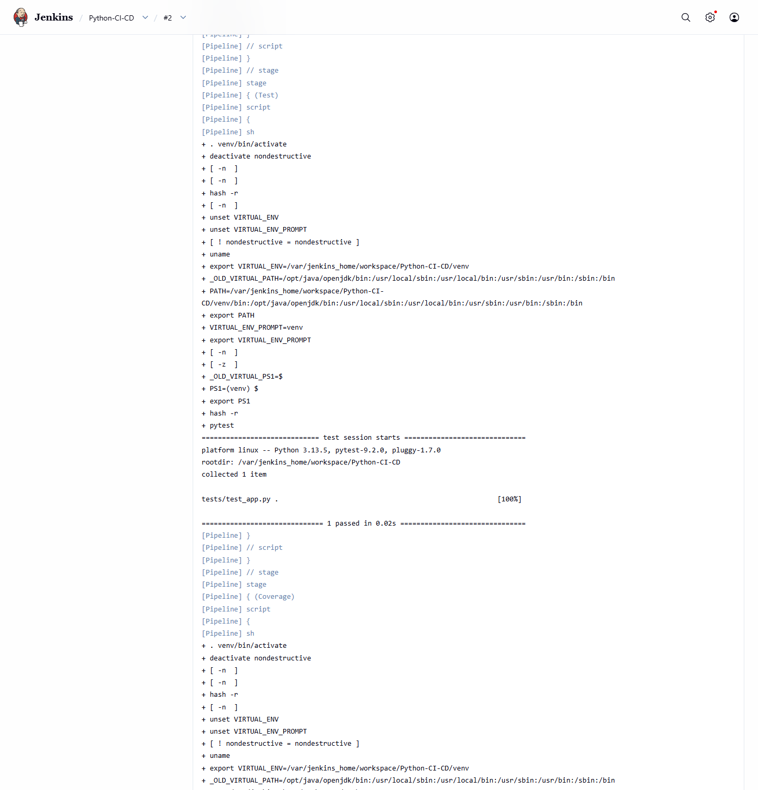

Build #2 console - Coverage stage report:

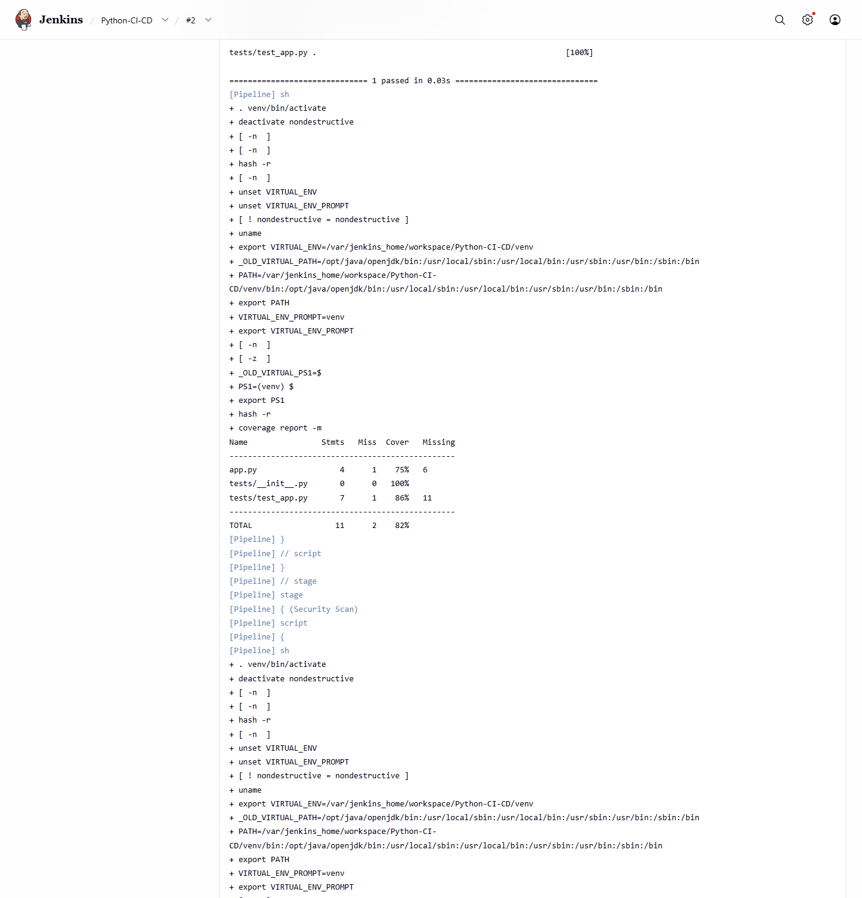

Build #2 console - Security Scan stage (bandit):

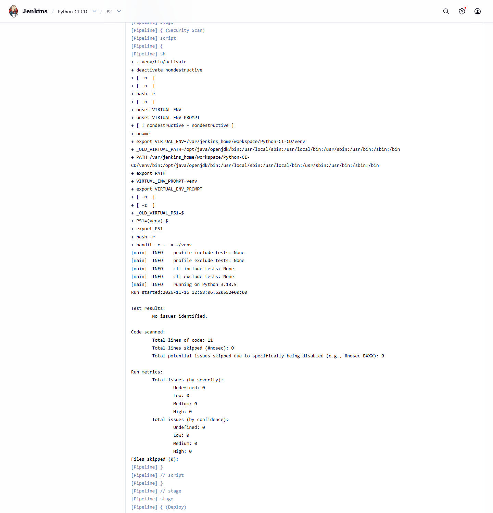

Build #2 console - Deploy stage and `Finished: SUCCESS`:

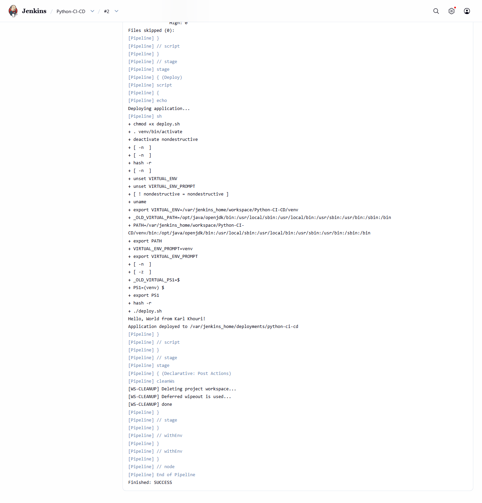
